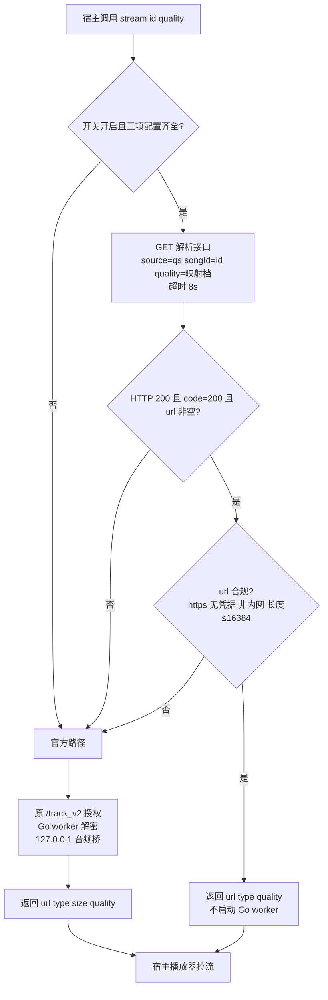

# 开工卡 0001 · 外部音源优先，官方授权回落

| 项 | 值 |
| --- | --- |
| 状态 | **已批准 · 已实现（沙箱测试通过，实机未验收）**（v1） |
| 方案版本 | v1 |
| 负责人 | zxbdzh |
| 批准边界 | 仅第 1 节范围；发版、推送到 GitHub、改动宿主均不在本卡内 |
| 适用仓库 | `zxbdzh/mygo-music-qishui-hybrid` @ `e951fad`（main） |
| 上游基线 | `lane128/mygo-music-qishui` v1.0.16 |

---

## 1. 交付与非目标

### 交付

在汽水插件里新增一个可选开关：**开启后，播放时先向一个解析服务要直链；拿不到合规直链就回落到现有的官方授权路径**。

1. `plugin.json` 新增三个设置项、一个网络权限、版本升到 `1.1.0`。
2. `src/plugin.mjs` 的 `stream()` 入口增加前置分支（不改 `/track_v2` 调用点，不改 `nativeMusic`）。
3. 新增 `helper/external-source.mjs`，承载音质映射、请求、地址校验与错误归一化。
4. 新增 `test/external-source.test.mjs`；扩展 `test/fixtures/plugin-sandbox.mjs` 支持注入 settings。
5. 重新生成 `index.js`（`npm run build`）。

### 明确后置（本卡不做）

- 多音源排序、优先级、按歌曲切源。
- 执行 LX 脚本或实现 `lx` 兼容层；只对接 HTTP 解析接口。
- 非汽水平台的 `songId` 映射（只有 `source=qs` 且 ID 同为汽水 track_id 才有效）。
- 音源登录、额度显示、音源更新提示。
- 播放中断后的自动换源（回落只发生在“拿链接”阶段）。
- 任何宿主、Go worker、音频桥改动。

---

## 2. 业务规则

### 2.1 开关与配置

| 设置键 | 类型 | 默认 | 说明 |
| --- | --- | --- | --- |
| `externalSourceEnabled` | `boolean` | `"false"` | 关闭时不发任何解析请求 |
| `externalSourceEndpoint` | `text` | 空 | 解析服务完整地址，必须以 `https://` 开头 |
| `externalSourceKey` | `password` | 空 | 作为 `X-API-Key` 发送，不得写入日志 |

`host.setting()` 一律返回字符串；`"true"` 才算开启。三项缺任一即视为未配置，直接走官方路径。

### 2.2 音质映射（宿主 `quality` → 解析接口 `quality`）

| 宿主 | 接口 |
| --- | --- |
| `standard` | `128k` |
| `high` | `320k` |
| `lossless` | `flac` |

未知值按 `high` 处理。**返回值必须如实回填实际档位**，不得沿用请求档位：接口只回 `128k` 时返回 `quality: "standard"`。

### 2.3 请求与判定

- 方法 `GET`，地址 `${endpoint}?source=qs&songId=${id}&quality=${q}`。
- 头：`X-API-Key`、`User-Agent: lx-music-desktop/2.99.0`、`Content-Type: application/json`。
- 超时 **8 秒**（`AbortController` + `setTimeout`，不要依赖 `AbortSignal.timeout`）。
- 成功条件：**`code === 200` 且 `url` 为非空字符串**。
  - 实测上游失败仍是 HTTP 200（`{"code":500,...}`），所以不能只看 HTTP 状态。
- 返回类型映射：`flac` → `flac`；`320k` / `128k` → `m4a`。

### 2.4 地址校验（拒绝即回落）

返回的 `url` 必须同时满足：

1. `https:` 协议；
2. 无 `username` / `password`；
3. 主机不是 `localhost`，不是私有/保留网段（`10.`、`127.`、`169.254.`、`172.16–31.`、`192.168.`、`::1`、`fc00::/7`）；
4. 长度 ≤ 16384。

> 原因：宿主 Go 侧会直接 GET 这个地址。允许内网地址等于把 SSRF 送进用户本机。

### 2.5 回落语义

- 任一环节失败（超时、非 200、业务码非 200、无 url、地址不合规、JSON 解析失败）→ **静默回落**，不影响用户感知，只写一条脱敏日志。
- 回落不修改 `session`、不写入 storage、不清理登录态。
- 走音源成功时**不得**调用 `music("stream", …, true)`：不要起 Go worker，不要占用音频桥。
- 直链不缓存；每次 `stream()` 重新解析。
- 不向宿主传 `size`（签名直链长度不可靠，会触发宿主的长度校验失败）。
- `download` 复用同一 `stream` 路径，因此下载同样走音源；这是预期行为。

### 2.6 权限

- `plugin.json` 的 `permissions.network` 追加解析服务域名（当前唯一支持 `source.shiqianjiang.cn`）。
- **不要**声明 `"*"`；要换服务时改 `plugin.json` 重新打包。
- 音频 CDN 域名不需要进权限：宿主拉音频不经过插件的 `fetch`。

---

## 3. 流程图



失败分支的共同结果：**保持原账号数据与登录态不变，播放仍由官方路径完成**。

---

## 4. 受影响模块与接口

| 模块 | 变更 |
| --- | --- |
| `plugin.json` | 新增 `settings` 三项；`permissions.network` 加域名；`version` → `1.1.0` |
| `src/plugin.mjs` | `stream()` 前置分支；失败静默回落；成功路径不带 `retained` |
| `helper/external-source.mjs` | 新增：`mapQuality`、`resolveExternal`、`assertSafeURL`、`resolveUrl` |
| `index.js` | 构建产物（`npm run build`） |
| `test/fixtures/plugin-sandbox.mjs` | 加 `settings` 注入；`host.setting` 不再无条件抛错 |
| `test/external-source.test.mjs` | 新增，见第 6 节 |

### 复用的现有接口

- 导出签名不变：`stream({ id, quality })` → `{ url, type, quality?, size? }`（宿主 `music.Stream` 字段：`url` / `type` / `quality` / `size` / `headers` / `gain` / `peak`）。
- 官方路径完全复用 `nativeMusic("stream")`，不改其超时、abort、`retained` 语义。

### 新增的外部接口（消费方，不是我们提供）

`GET {endpoint}?source=qs&songId={id}&quality={128k|320k|flac}`

- 头：`X-API-Key: {externalSourceKey}`、`User-Agent: lx-music-desktop/2.99.0`
- 200 成功体：`{"code":200,"url":"https://…","type":21,"message":"success"}`
- 失败体：`{"code":500,"message":"汽水音乐上游业务失败（status_code=1000091）"}`（HTTP 仍 200）

---

## 5. BDD 场景

**成功**
Given 开关开启、endpoint 与 key 已配置、解析服务返回 `code=200` 与 `https://cdn…/song.flac`
When 播放一首无损歌曲
Then 返回 `type: "flac"`、`quality: "lossless"`，且没有启动 `qishui-helper`

**拒绝**
Given 解析服务返回 `http://127.0.0.1/x` 或 `http://` 地址
When 播放
Then 该地址被拒绝，走官方路径，最终仍能播出；没有对内网地址发起任何请求

**失败后保留数据**
Given 解析服务返回 `code=500` 或超时
When 播放
Then 回落官方路径并成功播放；登录态、`session`、`feed-first-use` 等 storage 内容与播放前一致；日志不含 key 与签名参数

**未配置**
Given 开关关闭或任一项为空
When 播放
Then 不发起任何解析请求（断言请求列表里没有该域名）

**音质如实**
Given 请求 `lossless` 但服务只返回 `128k` 的链接
When 播放
Then 返回 `quality: "standard"`、`type: "m4a"`，不得标成无损

---

## 6. 关键失败测试草稿

放 `test/external-source.test.mjs`。复用 `test/fixtures/plugin-sandbox.mjs`（`vm.SourceTextModule` 直接加载真实 `index.js`）。

```js
import test from 'node:test'
import assert from 'node:assert/strict'
import { sandbox, json, session } from './fixtures/plugin-sandbox.mjs'

const endpoint = 'https://audio-source.test/api/music/url'
const settings = {
  externalSourceEnabled: 'true',
  externalSourceEndpoint: endpoint,
  externalSourceKey: 'test-key',
}
const track = { id: '7088232505400100866', quality: 'lossless' }

test('音源成功时不启动 Go worker', async () => {
  const box = await sandbox([], session, {
    settings,
    request: async url => String(url).startsWith(endpoint)
      ? json({ code: 200, url: 'https://cdn.test/song.flac' })
      : undefined,
  })
  const s = await box.api.stream(track)
  assert.equal(s.type, 'flac')
  assert.equal(s.quality, 'lossless')
  assert.equal(box.spawned(), 0)
})

test('内网地址被拒绝并回落官方路径', async () => {
  const box = await sandbox([[{ ok: true, result: { url: 'http://127.0.0.1:1/x', type: 'flac', quality: 'lossless', size: 1 } }]], session, {
    settings,
    request: async url => String(url).startsWith(endpoint)
      ? json({ code: 200, url: 'http://127.0.0.1:1/x' })
      : undefined,
  })
  const s = await box.api.stream(track)
  assert.equal(box.spawned(), 1)          // 走了官方 worker
  assert.match(s.url, /^http:\/\/127\.0\.0\.1:/) // 官方桥地址
})

test('业务码失败仍是 HTTP 200 也要回落', async () => {
  const box = await sandbox([[{ ok: true, result: { url: 'http://127.0.0.1:2/y', type: 'm4a', quality: 'high', size: 2 } }]], session, {
    settings,
    request: async url => String(url).startsWith(endpoint)
      ? json({ code: 500, message: '上游业务失败' })
      : undefined,
  })
  await box.api.stream({ id: track.id, quality: 'high' })
  assert.equal(box.spawned(), 1)
})

test('开关关闭时不请求解析服务', async () => {
  const box = await sandbox([[{ ok: true, result: { url: 'http://127.0.0.1:3/z', type: 'm4a', quality: 'high', size: 3 } }]], session, {
    settings: { ...settings, externalSourceEnabled: 'false' },
  })
  await box.api.stream({ id: track.id, quality: 'high' })
  assert.ok(!box.authCalls.some(c => String(c.url).startsWith(endpoint)))
})

test('请求 lossless 但只回 128k 时如实标 standard', async () => {
  const box = await sandbox([], session, {
    settings,
    request: async url => String(url).startsWith(endpoint)
      ? json({ code: 200, url: 'https://cdn.test/song.m4a' })
      : undefined,
  })
  const s = await box.api.stream(track)
  assert.equal(s.quality, 'standard')
  assert.equal(s.type, 'm4a')
})
```

**fixture 扩展点**：`plugin-sandbox.mjs` 的 `host.setting` 目前固定抛错。改为接受 `settings` 对象，未声明的键返回 `undefined`；其余行为不变。这是本卡允许改的测试基础设施范围。

**复用入口**：`npm run check` → `node --test test/*.test.mjs`（`npm test` 会连带跑 Go 模块）。

---

## 7. 集成前提与未覆盖

### 前提

- 已 `npm ci`（需要 esbuild）。
- 解析服务可用，且 `source=qs` 接受汽水 track_id（已实测：`7088232505400100866` 返回 flac/320k/128k 均 200）。
- 宿主 ≥ 0.1.20（`settings` 的 `boolean` / `password` 控件）。

### 未覆盖（验收时不得声称）

- Windows / macOS 实机播放未验证，仅在沙箱单测中验证。
- 直链 302 跳转后是否可播：已实测 128k 会跳 `ctydoh.cn`，宿主 Go 侧默认跟随；但本卡不验证宿主行为。
- 无损档在小众歌曲上的降档行为：服务可能直接返回 `code=500`，本卡只回落，不降档重试。
- 会员/试听限制、地区限制未验证。
- 音源服务自身的额度、限速、封 key 行为不在本卡范围。

---

## 8. 执行步骤（给新会话 agent）

1. 读 `AGENTS.md`、`docs/agents/workflow.md`、`docs/agents/engineering.md`、`docs/agents/quality-gates.md` 和本卡。
2. `npm ci`，然后 `npm run check` 确认基线产物一致。
3. 先写测试（第 6 节 5 条），再改 fixture，再实现 `helper/external-source.mjs`，最后改 `src/plugin.mjs`。
4. `npm run build` 生成 `index.js`。
5. 跑 `npm run check` 与 `node --test test/external-source.test.mjs test/playback.test.mjs test/plugin.test.mjs`。
6. 汇报：改动文件、测试命令与结果、未验证项、回滚方式。

### 禁止

- 不改宿主、不改 `native/` 下 Go 与 C++、不改 `helper/worker.mjs` 等验证适配器的语义。
- 不执行或内联任何第三方 LX 脚本。
- 不把 key 写进日志、测试夹具或提交内容。
- 不提交、不推送、不发版（需另行授权）。
- 不扩大 `permissions.network` 到 `"*"`。

---

## 9. 验收与回滚

### 验收

| 项 | 判定 |
| --- | --- |
| 开关关闭 | 播放行为与 v1.0.16 完全一致 |
| 开关开启且服务可用 | 返回音源直链，不启动 Go worker |
| 服务失败 | 回落官方路径，播放成功，数据不变 |
| 日志 | 不含 key、不含签名参数 |
| 产物 | `npm run check` 通过 |

### 回滚

- 运行时：把 `externalSourceEnabled` 改回 `false` 即回到官方路径，无需降级版本。
- 代码：`git revert` 单个提交；无数据迁移、无 storage 结构变更。
- 已下载/已播放的内容不受影响。

---

## 10. 批准记录

| 版本 | 范围 | 负责人 | 时间 | 结论 |
| --- | --- | --- | --- | --- |
| v1 | 第 1 节交付范围 | zxbdzh | 2026-11-25 | **已批准**（对话中“我允许开工了”） |

> 负责人对明确版本和范围的回复才构成批准；旧 Note、标签、任务分配或 Agent 自审不能替代。

## 11. 实现记录（2026-11-25）

### 改动

| 文件 | 内容 |
| --- | --- |
| `plugin.json` | settings 三项、`permissions.network` 加 `source.shiqianjiang.cn`、版本 `1.1.0` |
| `package.json`、`package-lock.json` | 版本同步 `1.1.0`（`RELEASE.md` 要求三份版本一致） |
| `src/plugin.mjs` | `stream()` 前置分支、`externalSourceSettings()`、`externalStream()` |
| `helper/external-source.mjs` | 新增：`mapQuality`、`resolveUrl`、`assertSafeURL`、`resolveExternal` |
| `scripts/package-layout.mjs` | `runtimeSource` 增加 `helper/external-source.mjs`（否则运行包缺模块） |
| `test/external-source.test.mjs` | 新增，12 条 |
| `test/fixtures/plugin-sandbox.mjs` | `settings` 注入（未注入时保持原抛错）、`console` 收集到 `logs` |
| `test/build/package-layout.test.mjs` | 运行时包清单断言补 `helper/external-source.mjs` |
| `index.js` | `npm run build` 产物 |

### 实现选择（计划未明确处）

- **实际档位判定**（真实服务实测后确定，见下）：优先响应体 `quality` 字段；否则看链接扩展名（`.flac` 为无损，明确的有损扩展名按容器降档）；扩展名缺失时按本次请求档位回填，因为真实 CDN 直链不带后缀，响应也不含档位。
- **日志**：宿主无专用日志 API，使用 `console.warn`，只输出 `timeout` / `failure` 归一化原因，不含 key 与直链。
- **地址校验**：在计划 4 条之外补 `0.0.0.0`、`::`、`localhost.` 尾点与 `::ffff:` 映射，避免绕过。
- **track_id 校验**：非 `/^\d{1,32}$/` 的 ID 不发给解析服务，直接走官方路径。

### 真实服务实测（2026-11-25）

- 提供的音源地址是 LX 脚本端点 `https://source.shiqianjiang.cn/api/script/lx`。按计划「不执行第三方 LX 脚本」，只读取脚本里声明的 HTTP 解析接口，未加载或运行脚本。
- 实际解析接口：`GET https://source.shiqianjiang.cn/api/music/url?source=qs&songId=<id>&quality=<128k|320k|flac>`，头 `X-API-Key`、`User-Agent`。
- 样本 `7245043407416150018` 三档均 `code=200`；响应字段 `code/message/name/server/serverName/type/url`，**无 `quality` 档位字段**，`type` 恒为 21。
- 直链主机 `sf6-cdn-tos.douyinstatic.com`，路径无扩展名。Range 取 16 字节验证容器：`flac` 档为 `fLaC`，`320k` / `128k` 档为 `ftypM4A`。
- 因此原「按扩展名判断、其余一律 standard」会把无损档错标成 `m4a`，已改为上面的三级判定，并补测试「CDN 直链没有扩展名时按请求档位回填」。
- 插件全链路实跑（沙箱加载真实 `index.js`，仅替换 `fetch` 为真实网络）：`lossless→flac/lossless`、`high→m4a/high`、`standard→m4a/standard`，均未启动 Go worker，`size` 不传，耗时 0.2–0.4 秒。
- ffprobe 直接读三档直链（不落盘）：`flac` 为 FLAC 24bit/44.1kHz、342.4 秒、1.58 Mbps；`320k` 为 AAC 257 kbps；`128k` 为 AAC 129 kbps。三档均可解码、时长一致，回填的 `type` 与实际容器相符。
- 无效密钥实跑：解析失败后回落官方路径，日志仅一条 `external source fallback: failure`，不含密钥。

### 测试

- `npm run check`：通过。
- `node --experimental-vm-modules --test test/external-source.test.mjs test/playback.test.mjs test/plugin.test.mjs`：57 条，0 失败，2 跳过。
- 全量 `test/*.test.mjs test/build/*.test.mjs`：355 条，1 条失败（`package-layout` 的 `native/signer/validate.mjs` 排除在 Windows 路径分隔符下不生效，已在 `ef6f547` 基线 worktree 复现，与本卡无关）。
- 变异检查：去掉业务码校验、开关校验、日志脱敏，对应测试分别失败。

### 未验证

- 实机播放（Windows/macOS 宿主）未验证：只在沙箱里拿到直链，宿主播放器拉流、seek、下载未验证。
- 服务降档但没有 `code=500` 的情况无法识别：扩展名缺失时按请求档位回填，此时可能把降档标高。
- 宿主设置页控件展示未在 MyGO 实机确认。
- `code=0` 成功体未兼容（LX 脚本兼容 0 与 200，实测只见到 200）。
- README / README.en.md 未更新（不在本卡范围，发布准备时处理）。

