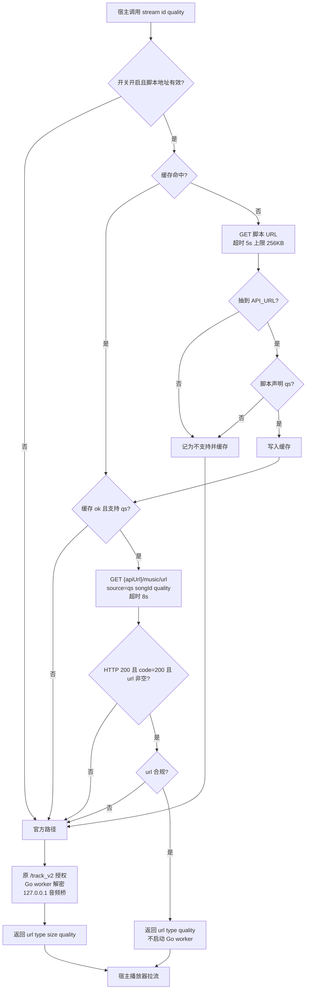

# 开工卡 0002 · LX 脚本导入与元数据抽取

| 项 | 值 |
| --- | --- |
| 状态 | **已批准 · 已实现（沙箱测试通过，实机未验收）**（v1） |
| 方案版本 | v1 |
| 负责人 | zxbdzh |
| 批准边界 | 仅第 1 节范围；发版、推送到 GitHub、改动宿主均不在本卡内 |
| 适用仓库 | `zxbdzh/mygo-music-qishui-hybrid` @ `0db93ec`（feat/external-source-first） |
| 上游基线 | `lane128/mygo-music-qishui` v1.0.16；本卡替换 0001 的配置形态 |

---

## 1. 交付与非目标

### 交付

把 0001 的「手填 HTTP 解析接口」改成「填一个 LX 脚本地址」：插件拉取脚本文本，只抽取其中的接口声明，不执行脚本。

1. `plugin.json`：设置改为 `externalSourceEnabled` + `externalSourceScript`；`permissions.network` 改为 `["*"]`；版本升到 `1.2.0`。
2. `helper/external-source.mjs`：新增脚本拉取、元数据抽取、缓存与不支持判定；`resolveExternal` 改为消费抽取结果。
3. `src/plugin.mjs`：前置分支改读新设置，失败仍静默回落官方路径。
4. `test/external-source.test.mjs`：改为脚本模式场景，补缓存与「无 qs」失败用例。
5. 重新生成 `index.js`（`npm run build`）。

### 明确后置（本卡不做）

- 执行 LX 脚本或模拟 `globalThis.lx`；只读脚本源文本。
- 非 `qs` 音源的跨平台 `songId` 映射。
- 多音源排序、优先级、按歌切源。
- 接入脚本里的 `lyric` / `pic` 等其它 action（歌词仍走汽水 SEO 接口）。
- 脚本自身的 `checkUpdate` 更新检查。
- 缓存过期与旧缓存清理。

---

## 2. 业务规则

### 2.1 配置

| 设置键 | 类型 | 默认 | 说明 |
| --- | --- | --- | --- |
| `externalSourceEnabled` | `boolean` | `"false"` | 关闭时不发任何请求 |
| `externalSourceScript` | `text` | 空 | LX 脚本完整地址，必须以 `https://` 开头；可自带 `?key=` |

- 删除 `externalSourceEndpoint` 与 `externalSourceKey`；旧键不再读取，值残留在宿主设置里无害。
- `host.setting()` 读不到（旧宿主/异常）视为未配置。
- 只认脚本地址：填成老的直连接口地址会解析失败，静默回落（v1 明确不作废兼容）。

### 2.2 脚本拉取与元数据抽取

- `GET {scriptURL}`，超时 **5 秒**，`redirect: 'error'`，响应上限 256 KB。
- 抽取三项（正则，不执行）：
  - `API_URL`：`API_URL\s*=\s*["'`](https?://[^"'`]+)["'`]`
  - `API_KEY`：`API_KEY\s*=\s*["'`]([^"'`]+)["'`]`（可缺省）
  - 是否含汽水音源：脚本中出现 `"qs"\s*:` 或 `'qs'\s*:`
- `API_URL` 抽不到、响应不像脚本（含 HTML/JSON）→ 记为**不支持**。
- `API_KEY` 缺失时，用脚本 URL 的 `?key=` 查询参数兜底；仍没有则该音源不发送 `X-API-Key`。
- `API_URL` 必须为 `https:` 且无账号密码。

### 2.3 缓存

- 键：`lx-script:` + `host.crypto.md5(scriptURL)`，值：

  ```json
  { "v": 1, "ok": true, "apiUrl": "https://…/api", "key": "…", "qs": true, "reason": "" }
  ```

- 成功与不支持都缓存；同键直接复用，不再拉脚本。
- 用户改地址（含换 key，URL 变化）→ 新键 → 重拉。
- 不做过期与清理；一个用户通常只有 1–2 条。
- `key` 与 0001 一样以明文存在插件 storage（与宿主设置同等安全级别）。

### 2.4 取地址

- 请求：`GET {apiUrl}/music/url?source=qs&songId={id}&quality={q}`，超时 **8 秒**。
- 头：`X-API-Key`（有才发）、`User-Agent: lx-music-desktop/2.99.0`、`Content-Type: application/json`。
- 成功条件：HTTP 200 且 `code === 200` 且 `url` 为非空字符串。
- 音质映射与 0001 相同：`standard→128k`、`high→320k`、`lossless→flac`；未知按 `high`。
- 档位回填沿用 0001 的三级判定：响应 `quality` > 链接扩展名 > 请求档位。
- 地址校验沿用 0001：`https:`、无凭据、非内网/保留地址、长度 ≤ 16384。

### 2.5 回落语义

- 拉脚本失败、超时、抽不到 `API_URL`、脚本无 `qs`、接口失败、业务码非 200、无 url、地址不合规 → **静默回落官方路径**，不影响用户感知。
- 每次回落只写一条脱敏日志：`external source fallback: <reason>`，`reason ∈ {timeout, script, unsupported, failure}`；不含 key、脚本 URL、直链。
- 不修改 `session`、不写 storage（除缓存键）、不清理登录态。
- 成功时不启动 Go worker，不传 `size`，不缓存直链。

### 2.6 权限

- `permissions.network` 改为 `["*"]`：脚本与接口域名由用户填写，无法预先枚举；这是本卡对 0001「不要声明 `*`」的明确覆盖。
- 音频 CDN 仍不需要进权限：宿主拉音频不经过插件 `fetch`。
- 安装/升级时宿主会提示「可访问任何网站」，属预期。

---

## 3. 流程图



所有失败分支的共同结果：保持登录态与账号数据不变，播放由官方路径完成。

---

## 4. 受影响模块与接口

| 模块 | 变更 |
| --- | --- |
| `plugin.json` | 设置替换为两项；`permissions.network` → `["*"]`；`version` → `1.2.0` |
| `src/plugin.mjs` | `externalSourceSettings()` 读新键；`externalStream()` 传脚本地址 |
| `helper/external-source.mjs` | 新增 `parseScript`、`scriptSource`（拉取+缓存）；`resolveExternal` 改为消费 `{apiUrl, key}` |
| `test/external-source.test.mjs` | 场景改为脚本模式；补缓存、无 qs、非脚本三类用例 |
| `test/fixtures/plugin-sandbox.mjs` | 若需断言 storage 缓存已可读；无需新增能力 |
| `index.js` | `npm run build` 产物 |

### 复用

- 导出签名不变：`stream({ id, quality }) -> { url, type, quality? }`。
- 官方路径完全复用 `nativeMusic("stream")`。
- 0001 的 `assertSafeURL`、`mapQuality`、档位判定、超时与回落结构保留。

### 外部接口（消费方）

- `GET {scriptURL}` → `application/javascript` 文本。
- `GET {apiUrl}/music/url?source=qs&songId=…&quality=…` → `{code:200,url,…}`。

---

## 5. BDD 场景

**成功**
Given 开关开启、脚本地址指向一个声明 `qs` 的 LX 脚本
When 播放一首无损歌曲
Then 返回 `type: "flac"`、`quality: "lossless"`，没有启动 `qishui-helper`

**缓存**
Given 同一个脚本地址已成功解析过
When 连续播放两首歌
Then 脚本只被拉取一次，两次都直接取地址

**不支持**
Given 脚本的 `MUSIC_QUALITY` 没有 `qs`
When 播放
Then 不请求取地址接口，回落官方路径并成功播放；日志一条 `unsupported`

**非脚本**
Given 配置里填的是直连接口地址（返回 JSON）
When 播放
Then 抽取失败，回落官方路径；不向该地址发取地址请求

**失败后保留数据**
Given 取地址接口返回 `code=500` 或超时
When 播放
Then 回落官方并成功播放；`session`、`feed-first-use` 等 storage 内容不变；日志不含 key 与直链

**地址拒绝**
Given 接口返回 `http://127.0.0.1/x`
When 播放
Then 拒绝该地址并回落官方，不对内网发起任何请求

---

## 6. 关键失败测试草稿

放 `test/external-source.test.mjs`，复用 `test/fixtures/plugin-sandbox.mjs`。

```js
import test from 'node:test'
import assert from 'node:assert/strict'
import { sandbox, json, session } from './fixtures/plugin-sandbox.mjs'

const scriptUrl = 'https://audio-source.test/api/script/lx?key=test-key'
const endpoint = 'https://audio-source.test/api/music/url'
const settings = { externalSourceEnabled: 'true', externalSourceScript: scriptUrl }
const track = { id: '7245043407416150018', quality: 'lossless' }
const script = [
  'const API_URL = "https://audio-source.test/api";',
  'const API_KEY = "test-key";',
  'const MUSIC_QUALITY = {"qs":["128k","320k","flac"]};',
].join('\n')
const js = body => new Response(body, { headers: { 'content-type': 'application/javascript' } })

test('脚本解析成功后走音源，不启动 Go worker', async () => {
  const box = await sandbox([], session, { settings, request: async url => {
    if (String(url) === scriptUrl) return js(script)
    if (String(url).startsWith(endpoint)) return json({ code: 200, url: 'https://cdn.test/song.flac' })
    return undefined
  } })
  const s = await box.api.stream(track)
  assert.equal(s.type, 'flac')
  assert.equal(s.quality, 'lossless')
  assert.equal(box.spawned(), 0)
})

test('脚本没有 qs 音源时回落官方', async () => {
  const box = await sandbox([[{ ok: true, result: { url: 'http://127.0.0.1:1/x', type: 'm4a', quality: 'high', size: 1 } }]], session, {
    settings,
    request: async url => String(url) === scriptUrl
      ? js('const API_URL = "https://audio-source.test/api";\nconst MUSIC_QUALITY = {"tx":["128k"]};')
      : undefined,
  })
  await box.api.stream(track)
  assert.equal(box.spawned(), 1)
  assert.equal(box.logs.at(-1).text, 'external source fallback: unsupported')
})

test('同一脚本只拉取一次', async () => {
  let pulled = 0
  const box = await sandbox([], session, { settings, request: async url => {
    if (String(url) === scriptUrl) { pulled++; return js(script) }
    if (String(url).startsWith(endpoint)) return json({ code: 200, url: 'https://cdn.test/song.flac' })
    return undefined
  } })
  await box.api.stream(track)
  await box.api.stream(track)
  assert.equal(pulled, 1)
})

test('填成直连接口地址时不再兼容', async () => {
  const box = await sandbox([[{ ok: true, result: { url: 'http://127.0.0.1:2/y', type: 'm4a', quality: 'high', size: 2 } }]], session, {
    settings: { externalSourceEnabled: 'true', externalSourceScript: endpoint },
    request: async url => String(url) === endpoint ? json({ code: 200, url: 'https://cdn.test/song.flac' }) : undefined,
  })
  await box.api.stream(track)
  assert.equal(box.spawned(), 1)
  assert.equal(box.logs.at(-1).text, 'external source fallback: script')
})
```

---

## 7. 集成前提与未覆盖

### 前提

- 已 `npm ci`。
- 样本脚本 `https://source.shiqianjiang.cn/api/script/lx?key=…` 可访问，且声明 `qs`。
- 已实测该接口对 `source=qs&songId=7245043407416150018` 返回 flac/320k/128k 三档可解码直链。

### 未覆盖（验收时不得声称）

- 不执行脚本，所以签名/加密/动态换源的 LX 脚本一律不支持；抽不到 `API_URL` 即判不支持。
- 第二个样本（ikun 脚本）没有 `qs`，导入后会被判不支持；不验证其 QQ/网易音源。
- 未验证 Windows/macOS 实机播放。
- 未验证脚本服务端更换 `API_URL` 后缓存何时失效（需用户改地址）。
- `"*"` 权限下的安全边界：插件仍只把 track_id 发到用户填写的脚本所声明的域名，但不执行脚本，也不发送账号凭据。

---

## 8. 执行步骤（给新会话 agent）

1. 读 `AGENTS.md`、`docs/agents/workflow.md`、`docs/agents/engineering.md`、`docs/agents/quality-gates.md`、本卡与 0001。
2. 先写第 6 节失败测试（红），再改 `helper/external-source.mjs`（抽取与缓存），最后改 `src/plugin.mjs` 与 `plugin.json`。
3. `npm run build` 生成 `index.js`。
4. `npm run check`、`node --experimental-vm-modules --test test/external-source.test.mjs test/playback.test.mjs test/plugin.test.mjs`。
5. 用真实脚本地址与 `7245043407416150018` 跑一次端到端，记录三档结果。
6. 汇报：改动文件、命令与结果、未验证项、回滚方式。

### 禁止

- 不执行、不内联、不 `eval` 任何第三方 LX 脚本。
- 不改宿主、不改 `native/` 下 Go 与 C++。
- 不把 key 写进日志、测试夹具或提交内容。
- 不提交、不推送、不发版（需另行授权）。

---

## 9. 验收与回滚

### 验收

| 项 | 判定 |
| --- | --- |
| 开关关闭 | 行为与 1.1.0 一致，不发任何脚本或接口请求 |
| 脚本可用 | 返回音源直链，不启动 Go worker |
| 脚本无 qs | 回落官方，播放成功，日志 `unsupported` |
| 脚本缓存 | 连续播放只拉一次脚本 |
| 服务失败 | 回落官方，数据不变 |
| 日志 | 不含 key、脚本 URL、直链 |
| 产物 | `npm run check` 通过 |

### 回滚

- 运行时：`externalSourceEnabled` 改回 `false` 即回到官方路径。
- 代码：`git revert` 本卡提交；缓存键不影响官方路径，可留在 storage。
- 已下载/已播放内容不受影响。

---

## 10. 批准记录

| 版本 | 范围 | 负责人 | 时间 | 结论 |
| --- | --- | --- | --- | --- |
| v1 | 第 1 节交付范围 | zxbdzh | 2026-11-26 | **已批准**（对话中“开工”） |

> 负责人对明确版本和范围的回复才构成批准；本卡的 `"*"` 权限与「不执行脚本」两项已由负责人在对话中逐项确认。

## 11. 实现记录（2026-11-26）

### 改动

| 文件 | 内容 |
| --- | --- |
| `plugin.json` | 设置改为 `externalSourceEnabled` + `externalSourceScript`；`permissions.network` → `["*"]`；版本 `1.2.0` |
| `package.json`、`package-lock.json` | 版本同步 `1.2.0` |
| `helper/external-source.mjs` | 新增 `parseScript`、`loadScript`（拉取 + 缓存）；`resolveExternal` 改为消费 `{apiUrl, key}` |
| `src/plugin.mjs` | `externalSourceSettings()` 读脚本地址；`externalStream()` 先解析脚本再取地址 |
| `test/external-source.test.mjs` | 重写为脚本模式，17 条 |
| `GLOSSARY.md`、`docs/adr/0001-lx-script-metadata-only.md` | 术语与决策记录 |
| `index.js` | `npm run build` 产物 |

### 实现选择

- **脚本识别**：只认 `API_URL` 声明；`API_KEY` 可缺省，缺省时用脚本 URL 的 `?key=`；`qs` 用 `"qs":` 判定，兼容对象字面量与 `JSON.parse` 两种写法。
- **缓存**：`lx-script:` + `md5(scriptURL)`，成功与失败都存；`v: 1` 供以后迁移。
- **日志**：`external source fallback: timeout | script | unsupported | failure`，不含 key、脚本地址、直链。
- **失败不重试**：脚本不支持时直接回落，不再请求取地址接口。

### 测试

- `npm run check`：通过。
- `node --experimental-vm-modules --test test/external-source.test.mjs`：17 条，0 失败。
- `node --experimental-vm-modules --test test/external-source.test.mjs test/playback.test.mjs test/plugin.test.mjs`：62 条，0 失败，2 跳过。
- 全量 `test/*.test.mjs test/build/*.test.mjs`：363 条，1 条失败——`test/worker.test.mjs` 的 `after` 在 Windows 上删除临时 helper 时报 EBUSY；已在 `0db93ec` 的独立 worktree 复现，与本卡无关。

### 真实服务实测

- 脚本 `https://source.shiqianjiang.cn/api/script/lx?key=…` → 抽出 `API_URL=https://source.shiqianjiang.cn/api`、`qs` 存在。
- 同一首歌连续三档：`lossless` 首播 569 ms（含拉脚本）返回 `flac/lossless`；`high` 186 ms、`standard` 193 ms 命中缓存；三档均未启动 Go worker。
- 第二个脚本 `https://c.wwwweb.top/script/lxmusic?key=…` 声明的是 `git/kg/kw/tx/wy`，无 `qs`：回落官方路径，日志 `external source fallback: unsupported`。

### 未验证

- 实机播放（Windows/macOS 宿主）。
- 脚本服务端更换 `API_URL` 后，缓存要等用户改地址才刷新。
- `"*"` 权限下宿主安装提示的实际文案。

