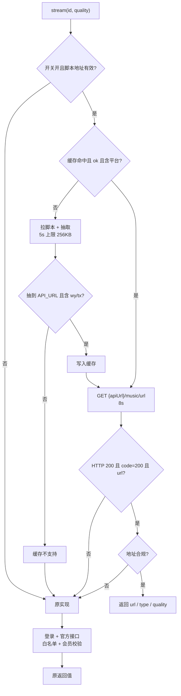

# 开工卡 0003 · 网易云与 QQ 音乐插件：音源解析 + 官方回落

| 项 | 值 |
| --- | --- |
| 状态 | **已实施**（2026-11-26） |
| 方案版本 | v1 |
| 负责人 | zxbdzh |
| 批准边界 | 仅第 1 节范围；两处 fork、各自 Release 需另行授权 |
| 目标仓库 | `sogud/mygo-music-netease`（127★）、`Amamiya23/mygo-music-qq-plugin`（12★），均 AGPL-3.0 |
| 参考实现 | 本仓库 0002（`helper/external-source.mjs`）与 `docs/research/2026-11-26-music-plugin-playback-fallback.md` |

---

## 1. 交付与非目标

### 交付

给两个插件各加一层「先向 LX 音源取直链，失败静默回落原实现」的播放前置分支，做法与汽水插件 0002 一致。

1. 每个仓库新增 `external-source.mjs`（从 0002 移植，`source` 参数化为 `wy` / `tx`）。
2. 两个 `index.js` 的 `stream()` 顶部插入前置分支。
3. `plugin.json` 增加 `externalSourceEnabled` / `externalSourceScript`，`permissions.network` 改为 `["*"]`，版本各自升 minor。
4. 两个仓库的测试文件补对应用例。
5. 各自重新打包发布（`netease-<version>.zip`、QQ 的 `dist/`）。

### 明确后置

- 不改插件的登录、歌单、歌词、封面、评论逻辑。
- 不做跨平台 ID 映射（两边的 ID 天然对齐，见 2.2）。
- 不做多音源优先级。
- 不接入脚本的 `lyric` / `pic` action。
- 不向上游提 PR（上游 README 明确声明「不会绕过权限」，与本卡定位冲突）。

---

## 2. 业务规则

### 2.1 配置

| 设置键 | 类型 | 默认 | 说明 |
| --- | --- | --- | --- |
| `externalSourceEnabled` | `boolean` | `"false"` | 关闭时不发任何音源请求 |
| `externalSourceScript` | `text` | 空 | LX 脚本完整地址，`https://` 开头，可自带 `?key=` |

- `permissions.network` → `["*"]`。
- 设置文案沿用 0002 的措辞，说明「只读取脚本声明，不执行脚本」。

### 2.2 平台与 ID

| 插件 | `stream({id})` 收到的 | LX `source` | LX 需要的 `songId` | 对齐 |
| --- | --- | --- | --- | --- |
| 网易云（sogud） | 数字 songId（`trackIdentity().audio`） | `wy` | 数字 songId | **直接一致** |
| QQ（Amamiya23） | songmid（`t.mid`） | `tx` | songmid | **直接一致** |

两个插件都不需要任何映射层。

### 2.3 脚本处理

与 0002 完全一致：

- `GET {scriptURL}`，5 秒超时，响应上限 256 KB，只做正则抽取，不执行。
- 抽 `API_URL`、`API_KEY`（缺省用 URL 的 `?key=`）、是否声明对应平台（`"wy":` 或 `"tx":`）。
- 缓存键 `lx-script:` + `md5(scriptURL)`，成功与失败都缓存。
- 脚本不含对应平台 → 判不支持，回落。

### 2.4 取地址与回填

- `GET {apiUrl}/music/url?source=wy|tx&songId=…&quality=…`，8 秒超时，带 `X-API-Key`、`User-Agent`。
- 档位映射：`standard→128k`、`high→320k`、`lossless→flac`；未知按 `high`。
- 成功条件：HTTP 200 且 `code === 200` 且 `url` 非空。
- 地址校验沿用 0002（https、无凭据、非内网、≤16384）。

**容器回填与汽水不同**（实测）：

| 平台 | flac 档 | 320k / 128k 档 |
| --- | --- | --- |
| qs（汽水） | `fLaC` | `ftypM4A` |
| wy（网易云） | `fLaC` | `ID3`（MP3） |
| tx（QQ） | `fLaC` | `ID3`（MP3） |

所以回填规则：请求 `flac` 成功 → `type: "flac"`；请求 `128k/320k` 成功 → `type: "mp3"`。响应里若带 `quality` 字段则优先；链接带明确后缀时按后缀。

### 2.5 会员曲目

负责人已明确选择「**能放**」：插件**不做任何 VIP 判断**，音源拿得到就用，拿不到（如实测 `wy/186016` 返回 HTTP 500）才回落官方。

需要如实记录的边界：

- 未用非会员账号做 A/B 对照，因此**不能证明**该实现能绕过会员限制。
- 实测结果只有：部分曲目返回完整时长（如 `wy/28815250` 302 秒 flac），个别曲目直接 HTTP 500。
- 上游 README 均声明「不会绕过权限」。fork 后必须同步修改这两处声明，避免误导。

### 2.6 回落

- 任一环节失败 → 静默回落原 `stream()`，保留其登录态、-460 重试、白名单、会员校验等全部行为。
- 每次回落只写一条脱敏日志：`external source fallback: timeout|script|unsupported|failure`。
- 成功时不写 storage（除脚本缓存）、缓存直链、传 `size`。

---

## 3. 流程图



---

## 4. 受影响模块

| 仓库 | 文件 | 变更 |
| --- | --- | --- |
| sogud | `index.js` | `stream()` 前插 `externalStream()`；新增脚本与取地址函数 |
| sogud | `plugin.json` | 两个设置项；`network: ["*"]`；版本 → `0.2.0` |
| sogud | `index.test.mjs` | 补脚本模式、缓存、无 `wy`、回落、容器回填用例 |
| sogud | `README.md`、`TODO.md` | 说明外部音源；改写「不绕过权限」的表述 |
| Amamiya23 | `index.js` | 同上，`source=tx` |
| Amamiya23 | `plugin.json` | 两个设置项；`network: ["*"]`；版本 → `0.4.0` |
| Amamiya23 | `*.test.mjs`、`dist/` | 能力同上；`npm run build` 重新生成 `dist/` |
| Amamiya23 | `README.md` | 说明外部音源；改写「不绕过权限」的表述 |

两边都不需要新依赖：`external-source.mjs` 只用 `fetch`、`URL`、`AbortController`、`host.storage`、`host.crypto.md5`。

---

## 5. BDD 场景

**成功（网易云）**
Given 开关开启、脚本声明 `wy`
When 播放一首无损歌曲
Then 返回 `flac` 类型，宿主能播放；不发送官方 `enhance/player/url/v1` 请求

**成功（QQ）**
Given 开关开启、脚本声明 `tx`，歌曲 id 是 songmid
When 播放
Then 返回 `flac` 或 `mp3`，不再请求 vkey

**缓存**
Given 同一脚本已解析过
When 连续播放两首
Then 脚本只被拉取一次

**不支持**
Given 脚本只声明 `tx`，却在网易云插件里使用
When 播放
Then 不请求取地址接口，回落官方，日志 `unsupported`

**回落保持原行为**
Given 取地址返回 HTTP 500（实测 `wy/186016`）
When 播放
Then 走原 `stream()`，白名单与会员提示照常工作

**容器**
Given 请求 `320k` 成功
When 返回
Then `type` 是 `mp3` 而不是 `m4a`

---

## 6. 关键失败测试草稿

sogud（`index.test.mjs`，沿用其现有异步测试风格）：

```js
test('音源成功时不再请求官方取流接口', async () => {
  const env = await load({ settings: { externalSourceEnabled: 'true', externalSourceScript: SCRIPT } })
  env.route(SCRIPT, () => jsonText(SCRIPT_BODY_WY))
  env.route(API + '/music/url', () => json({ code: 200, url: 'https://m801.music.126.net/a.flac' }))
  const s = await env.api.stream({ id: '347230', quality: 'lossless' })
  assert.equal(s.type, 'flac')
  assert.equal(env.callsTo('/api/song/enhance/player/url/v1').length, 0)
})

test('脚本没有 wy 时回落官方', async () => {
  const env = await load({ settings: { externalSourceEnabled: 'true', externalSourceScript: SCRIPT } })
  env.route(SCRIPT, () => jsonText(SCRIPT_BODY_TX_ONLY))
  await env.api.stream({ id: '347230', quality: 'high' })
  assert.equal(env.callsTo('/api/song/enhance/player/url/v1').length, 1)
  assert.equal(env.logs.at(-1), 'external source fallback: unsupported')
})

test('320k 回填 mp3 而不是 m4a', async () => {
  const env = await load({ settings: { externalSourceEnabled: 'true', externalSourceScript: SCRIPT } })
  env.route(SCRIPT, () => jsonText(SCRIPT_BODY_WY))
  env.route(API + '/music/url', () => json({ code: 200, url: 'https://m801.music.126.net/b.mp3' }))
  const s = await env.api.stream({ id: '347230', quality: 'high' })
  assert.equal(s.type, 'mp3')
})

test('接口 500 时回落且不改登录态', async () => {
  const env = await load({ settings: { externalSourceEnabled: 'true', externalSourceScript: SCRIPT } })
  env.route(SCRIPT, () => jsonText(SCRIPT_BODY_WY))
  env.route(API + '/music/url', () => new Response('', { status: 500 }))
  const before = env.snapshotStorage()
  await env.api.stream({ id: '186016', quality: 'lossless' })
  assert.equal(env.snapshotStorageWithoutCache(), before)
})
```

> 落地时按各仓库已有的测试夹具改写；`load`/`route` 是示意，不是既有 API。

---

## 7. 集成前提与未覆盖

### 前提

- 已 `gh repo fork` 两个仓库到 `zxbdzh/`，保留 AGPL-3.0 与版权头。
- 本地可运行各自的测试：sogud `npm test`；Amamiya23 `npm test` + `npm run build`。
- LX 脚本地址可用（`source=wy` / `source=tx` 实测均 `code=200`）。

### 未覆盖

- **不能证明绕过会员**：没有非会员账号做 A/B 对照。
- 未验证两个插件的登录态、-460 风控、地区限制在音源介入后的表现。
- 未验证 QQ 的 songmid 与 LX `tx` 音源对所有曲目一一对应（只抽样 4 首）。
- 未验证歌词、封面、评论是否受影响（预期不受影响，因为不改这些函数）。
- 未做 macOS / Windows 实机播放。

---

## 8. 执行步骤

1. 读本卡、0002 与调研文档；确认两个上游仓库的当前版本。
2. fork 两个仓库到 `zxbdzh/`，保留 LICENSE 与 NOTICE。
3. 先做网易云：移植 `external-source.mjs` → 写第 6 节测试（红）→ 插入 `stream()` 前置分支 → 改 `plugin.json` → 绿。
4. 再做 QQ：同样流程，`source=tx`，`type` 映射按 2.4。
5. 各自跑测试与打包；`pack.py` / `npm run build` 生成安装包。
6. 各自发 Release（需另行授权）。
7. 汇报：改动、测试结果、真实曲目抽样、未验证项、回滚方式。

### 禁止

- 不执行、不 `eval` 任何第三方 LX 脚本。
- 不修改上游的登录、风控、会员校验逻辑。
- 不把 key 写入日志、测试夹具或提交内容。
- 不向上游仓库推送改动或提 PR。
- 不在未授权时创建 fork 或 Release。

---

## 9. 验收与回滚

| 项 | 判定 |
| --- | --- |
| 开关关闭 | 行为与改前完全一致 |
| 脚本可用 | 返回音源直链，不再请求官方取流接口 |
| 脚本无对应平台 | 回落官方，日志 `unsupported` |
| 接口失败 | 回落官方，原提示照常 |
| 容器 | 320k/128k 回填 `mp3`，flac 回填 `flac` |
| 产物 | 各自测试与打包通过 |

回滚：设置里关掉开关即回到改动前行为；代码可 `git revert`；两个仓库独立，可分别回退。

---

## 10. 批准记录

| 版本 | 范围 | 负责人 | 时间 | 结论 |
| --- | --- | --- | --- | --- |
| v1 | 第 1 节交付范围（两个 fork 各加一层音源分支） | zxbdzh | 2026-11-26 | **已批准并实施** |

> 会员曲目策略「能放」已由负责人在对话中确认；fork 与发布仍需单独授权。

---

## 11. 实施记录（2026-11-26）

状态改为 **已实施**，两个仓库各自发布：

| 仓库 | 版本 | Release | 安装包 |
| --- | --- | --- | --- |
| `zxbdzh/mygo-music-netease` | 0.2.0 | `v0.2.0` | `netease-0.2.0.zip`（35 KB） |
| `zxbdzh/mygo-music-qq-plugin` | 0.4.0 | `v0.4.0` | `qqmusic-0.4.0.zip`（139 KB） |

### 落地方式

- 网易云：仓库没有构建链，`external-source` 逻辑**内联进 `index.js`**，`pack.py` 不变。
- QQ：`build.mjs` 用 esbuild 打包，新增独立 `external-source.js` 由入口 import，最终仍打成单文件 `dist/index.js`。

### 与卡片预想的差异

1. **`wy` 直链是 `http://`**。卡片只按 https 设计，实测 `m701/m801.music.126.net` 返回 http。实现改为同主机升级到 https 后再校验（实测 https 返回 206），保持只接受 https 的约定。
2. **QQ 增加非 songmid 短路**：`id` 不是 10–20 位字母数字时直接跳过外部音源，避免把节目等合成 id 送进音源接口。
3. **QQ 的 `headers`** 沿用原实现（`Referer: https://y.qq.com/`），因为音源直链同样走 QQ CDN。

### 验证结果

| 项 | 结果 |
| --- | --- |
| 网易云 `node --test index.test.mjs` | 54 项通过（原 46 + 新 8） |
| QQ `npm test` | 76 项，73 通过、3 跳过、0 失败（新 5 条） |
| 网易云真实链路 `wy/347230` | lossless→flac（m701）、high→mp3、standard→mp3，无回落日志，脚本缓存 1 条 |
| QQ 真实链路 `tx/0039MnYb0qxYhV` | lossless→flac、high→mp3、standard→mp3 |
| 坏 songmid `tx/000MkMni19ClKG` | HTTP 500 → 回落，日志 `failure` |

### 仍未验证

- 未在 MyGO 里实际安装这两个 ZIP 播放。
- 未用非会员账号做对照，**依然不能证明**绕过会员限制。
- 未验证 `-460` 风控、地区限制、歌词与封面在音源介入后的表现。

---

## 12. 扩展：无损档取最高音质（2026-11-26）

负责人选择「方案 A：在无损档内直接拉最高」，并同意增加前置容器校验。

### 实测规格

| 平台 | 请求档位 | 实际返回 | 体积 / 码率 |
| --- | --- | --- | --- |
| wy | `flac` | 16bit / 44.1k | 31 MB · 798 kbps |
| wy | `flac24bit`、`hires` | **降档为 16bit / 44.1k** | 同上 |
| wy | `atmos` | 24bit / 96k | 107 MB · 2755 kbps |
| wy | `master` | **24bit / 192k** | 173 MB · 4460 kbps |
| tx | `flac` | **24bit / 44.1k** | 55 MB · 1643 kbps |
| tx | `flac24bit`、`hires` | 链接 **403**（死链） | — |
| tx | `atmos` | 16bit / 44.1k（非真高解析） | 31 MB |
| tx | `atmos_plus` | 16bit / 44.1k **6ch** | 80 MB |
| tx | `master` | HTTP 500 | — |
| qs | `flac` | **24bit / 44.1k** | 64 MB · 1576 kbps |

两个发现决定了实现方式：

1. **wy 请求 `master` 会按歌自动降档**。抽 7 首，6 首给 24/192，1 首给 16/44.1。不需要写阶梯重试。
2. **接口回 `code=200` 不代表能播**。tx 的 `flac24bit`/`hires` 就是 403 死链。

### 实现

- `lossless` 请求档：wy → `master`；tx → `flac`；qs 不变（本身已是 24bit，无更高档）。
- 返回前 `Range: bytes=0-8191` 取前 8KB，按魔数认容器（`fLaC`/`ID3`/帧同步/`ftyp`/`OggS`/`RIFF`），失败即抛错回落官方。
- `type` 与 `quality` 改由字节决定：请求无损却拿到 MP3 时标 `high`，不再谎报。
- 宿主 `music.Qualities` 只有 `standard`/`high`/`lossless`，因此高解析在界面里仍显示「无损」；解码器按 `BitsPerSample` 归一化，24bit 不会被截断。

### 版本

| 仓库 | 版本 | Release |
| --- | --- | --- |
| `zxbdzh/mygo-music-netease` | 0.3.0 | `v0.3.0` |
| `zxbdzh/mygo-music-qq-plugin` | 0.4.1 | `v0.4.1` |

### 验证与未验证

- 网易云测试 56 项通过；QQ 全量 77 项（74 通过 / 3 跳过）。
- 真实链路：wy `347230` 无损拿到 24/192，`2023699757` 自动降为 16/44.1；tx 无损拿到 24/44.1；坏 songmid 回落。
- 代价：首播多一次 8KB Range 请求，实测首次约 540–580ms，命中脚本缓存后约 300ms。
- **未验证**：24/192 在 MyGO 里能否真实出声与流畅拖动；6 声道只播前两声道（宿主解码器注释已声明）。
